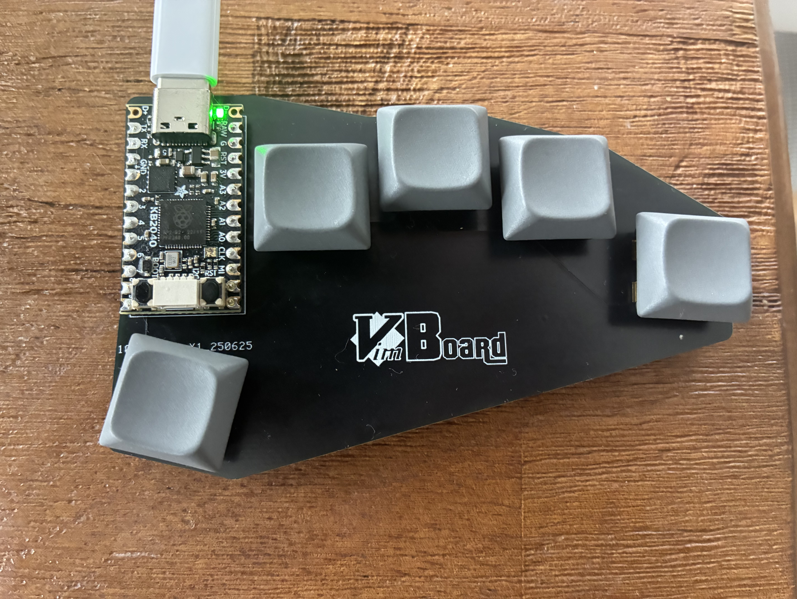
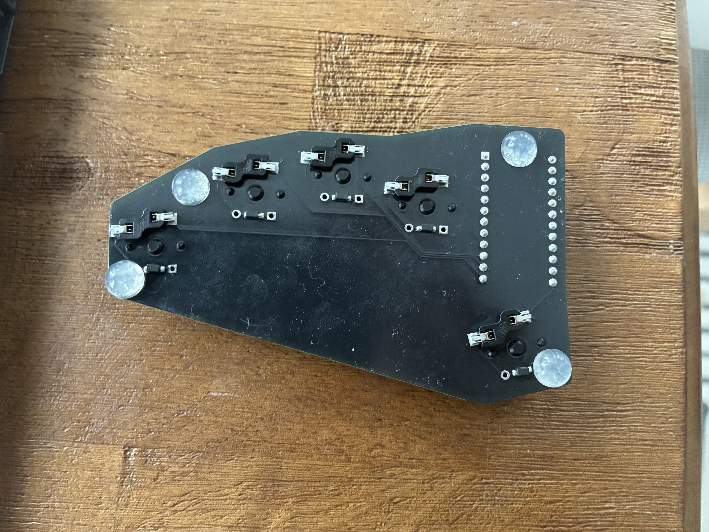
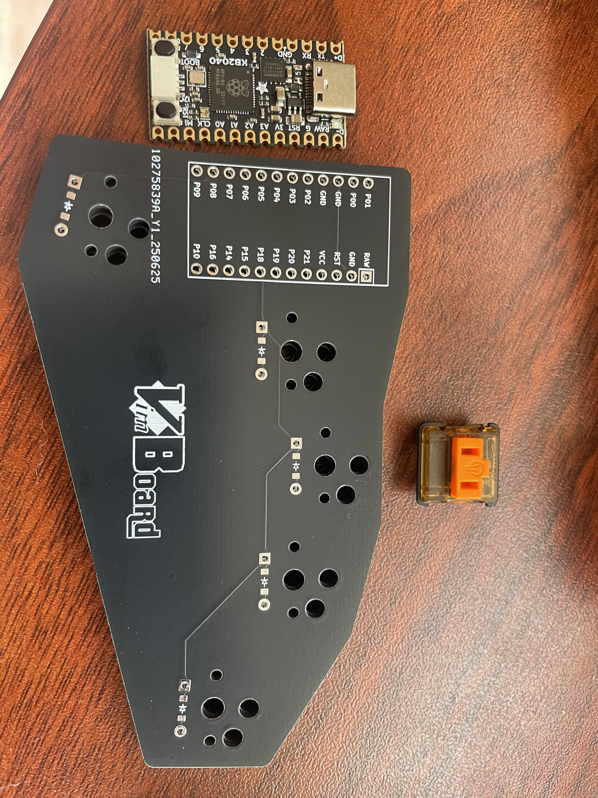

# Vimboard
A custom keyboard, ergonomically designed for optimal vim-motion navigation. The very pinnacle of practicality.

## Keymap
Keys are `H`, `J`, `K`, `L`, with a layer key at the thumb. Layer 2 is `W`, `E`, `B`, `T`.

## Hardware
Kailh sunset choc v1 switches with hotswap sockets. Adafruit KB2024 microcontroller, also socketed.

## Licensing
- All original Vimboard files (PCB, schematics, and keymaps) are licensed under the MIT License (see LICENSE).
- QMK Firmware is licensed under GPLv2. See [QMK’s license](https://github.com/qmk/qmk_firmware/blob/master/LICENSE).
- Ergogen is licensed under MIT.
- KiCad files are original works and licensed under MIT.
